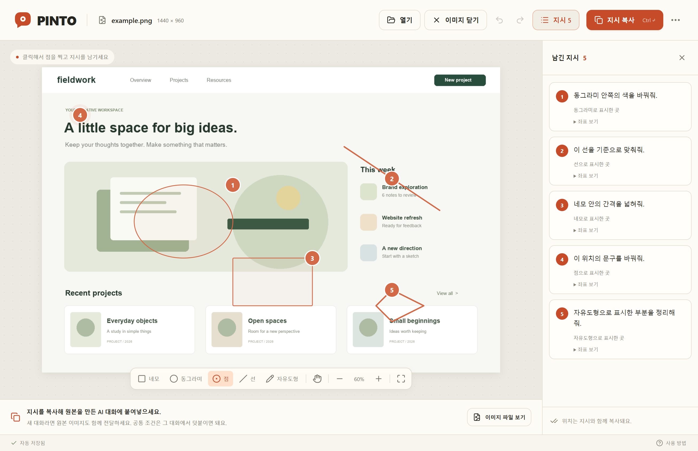

# PINTO

[English](README.md) · [Español](README.es.md) · [한국어](README.ko.md)

한국어·영어·스페인어를 지원합니다. 창 하단의 언어 선택은 재실행 후에도 유지됩니다. 버튼·도움말·오류·복사문은 선택한 언어로 표시하며, 사용자가 쓴 지시는 변경하지 않습니다. [영어 실제 예시](docs/examples/pinto-en.mp4) · [스페인어 실제 예시](docs/examples/pinto-es.mp4)


**이미지 위에 콕. AI에게 바로 전달.**

이미지에서 위치를 찍거나 영역을 드래그하고 지시를 적으세요. PINTO가 참고 이미지 경로와 픽셀 좌표를 함께 복사합니다. Windows와 macOS에서 독립된 창으로 실행하며, 로컬 AI가 읽을 수 있는 작업 폴더에 이미지를 보관합니다.

## thread0에서 설치하기

아래 문장을 thread0의 Claude Code 또는 Codex에 붙여넣으세요.

```text
https://github.com/GenDistrict/pinto
이 앱 깔아줘. INSTALL.md를 읽고 설치한 다음 실행까지 해줘.
```

Git이나 Node.js를 미리 설치할 필요가 없습니다. AI가 Git clone 또는 [소스 ZIP](https://github.com/GenDistrict/pinto/archive/refs/heads/main.zip)으로 내려받고, 설치 스크립트가 필요한 실행 환경을 준비합니다. 최초 설치에는 인터넷 연결과 AI의 로컬 명령 실행 권한이 필요합니다.

thread0의 Claude Code 또는 Codex에 **이 저장소 URL과 “PINTO 깔아줘”**를 전달하세요. AI는 [INSTALL.md](INSTALL.md)를 읽고 소스를 내려받아 실행 환경을 준비한 뒤 앱을 엽니다. 사용자용 개발자 인증서나 공증 설정은 필요하지 않습니다.

설치하는 AI는 앱 화면이 준비된 것을 확인한 뒤 **이 앱의 로컬 소스를 직접 수정해서 쓸 수 있다는 사실**과 소스 위치·실행 방법을 같은 대화에 안내해야 합니다. 완료 정보는 `.pinto/install-result.json`에도 저장됩니다.

다운로드한 소스 폴더에서 직접 설치할 수도 있습니다.

```powershell
# Windows PowerShell
./install.ps1
```

```sh
# macOS
sh ./install.sh
```

작업 폴더 옵션은 선택 사항입니다. AI가 이미 읽을 수 있는 현재 프로젝트 폴더를 지정하는 것을 권장합니다. 일반적인 설치는 사용자 영역에서 수행하며, 운영체제나 thread0의 실행 권한은 해당 환경의 정책을 따릅니다.

Windows 10 이상(x64·ARM64), macOS 13.5 이상(Intel·Apple Silicon)을 대상으로 합니다. 실제 검증 현황은 [검증 기록](docs/VERIFICATION.md)에 따로 기록합니다. Linux는 이번 버전의 지원 대상에 포함하지 않습니다.

## 사용하기



1. 이미지를 드롭하거나 붙여넣습니다. PNG·JPEG·WebP를 지원합니다.
2. **네모·동그라미·점·선·자유도형** 중 원하는 도구를 고릅니다. 점은 클릭하고, 나머지는 드래그해서 표시한 뒤 바로 지시를 입력합니다. 동그라미는 원·타원을 그릴 수 있으며, 자유도형은 손으로 그리는 방식입니다.
3. 다른 곳에 표시하면 다음 지시를 작성할 수 있습니다. 같은 지시에 대상을 더하려면 **대상 추가** 또는 Shift+클릭·드래그를 사용합니다. 도형 종류가 달라도 한 지시에 묶을 수 있습니다.
4. **지시 복사** 또는 Ctrl+Enter / ⌘Enter를 누릅니다.
5. **원본을 만든 AI 대화의 다음 메시지에 붙여넣습니다. 새 대화라면 원본 이미지도 함께 전달합니다.** 로컬 파일을 읽는 AI는 복사된 참고 경로를 사용할 수 있습니다. 이미지가 자동으로 첨부되지는 않습니다.

실행 취소·다시 실행, 지시 목록, 확대·이동, TXT 저장, 자동 저장과 최근 작업 복원을 제공합니다. 공통 조건은 AI 대화에서 지시와 함께 적으면 됩니다. 화면 아래 **이미지 파일 보기**로 표시가 없는 참고 파일을 찾아 첨부할 수 있습니다. 이미지 회전 정보는 저장된 참고 이미지와 화면에 동일하게 반영합니다. 이미지 한 변은 16,000px, 총 6,400만 픽셀, 입력 파일은 64MB까지 지원합니다.

이미지와 메모는 자동 보관합니다. 저장 위치를 바꿀 때만 **더 보기 → 이미지 보관 폴더 변경**을 사용하세요. 이 설정은 파일 보관 위치를 정하는 기능입니다.

이미지를 화면에서 비우려면 상단 **이미지 닫기**를 누르세요. 작성한 지시는 자동 저장되며 시작 화면의 최근 작업에서 다시 열 수 있습니다.

## 여러 이미지 작업

이미지를 여러 장 열거나 한꺼번에 드롭하면 한 작업으로 묶입니다(최대 20장). 썸네일을 눌러 전환하고, **이미지 추가**로 현재 작업에 더 넣으세요. **열기**는 새 작업을 시작합니다. 이미지별 표시·지시와 전환 중 실행 취소 기록을 유지합니다.

대상 이미지들을 체크하고 **선택한 이미지에 지시 추가**를 누르면 공통 지시를 적을 수 있습니다. 필요하면 참고 이미지를 골라 “1번의 색감을 2번에 적용”처럼 요청하세요. **전체 지시 복사**와 TXT 내보내기는 이미지별 파일 경로·번호·원본 좌표와 공통/참고 지시를 함께 전달합니다.

**작업 닫기** 후 최근 작업에서 전체 묶음을 다시 열 수 있습니다. 썸네일에서 제외해도 원본 파일과 지시는 삭제하지 않습니다. 공통 지시가 참조하는 이미지는 해당 지시를 수정하거나 삭제한 후 제외할 수 있으며, 다른 이미지 번호는 바뀌지 않습니다. 일부 파일을 열지 못해도 성공한 이미지는 보관하고 실패 원인을 알려줍니다. 보관 폴더 변경은 단일 이미지 작업에서 먼저 진행하세요.

실제 편집은 에이전트가 수행합니다. 로컬 파일을 읽을 수 없는 새 대화라면 사용한 원본들을 함께 전달하세요.

## 원하는 대로 고쳐 쓰기

AI에게 “코멘트 글자를 크게 해줘”, “단축키를 바꿔줘”, “복사되는 지시문 형식을 바꿔줘”라고 요청할 수 있습니다. 새 AI 세션에는 앱의 **더 보기 → 앱 수정 안내 복사**로 소스 위치와 실행 방법을 전달하세요.

코드는 [AGENTS.md](AGENTS.md)의 구조 안내에 따라 수정합니다. 이미지와 코멘트는 소스와 별도로 저장합니다. 개인 수정은 자동 업데이트로 덮어쓰지 않습니다. [업데이트·복구 안내](docs/MAINTENANCE.md)를 참고하세요.

## 개발 명령

Node.js 22.12 이상이 필요합니다. 버전과 패키지는 잠금 파일을 기준으로 설치합니다.

```sh
npm ci
node node_modules/electron/install.js
npm run check
npm test
npm run build
npm start
```

```sh
# AI가 특정 이미지와 작업 폴더를 지정해 열기
npm start -- --image '/path/to/image.png' --workspace '/path/to/project'

# 터미널 프로세스와 분리해서 실행하고 준비 결과 받기
node scripts/launch.mjs --image '/path/to/image.png' --workspace '/path/to/project'

# 환경 확인 / 실제 Electron UI 테스트
npm run doctor -- --json
npm run test:e2e
```

브랜드는 [PINTO 가이드](brand-concepts/index.html), 제품 범위는 [최종 기획안](docs/PRODUCT_PLAN.md)에 정리되어 있습니다.

## 라이선스

[MIT](LICENSE). 소스를 내려받아 사용·수정·재배포할 수 있습니다. 외부 의존성은 각 패키지의 라이선스를 따릅니다.
