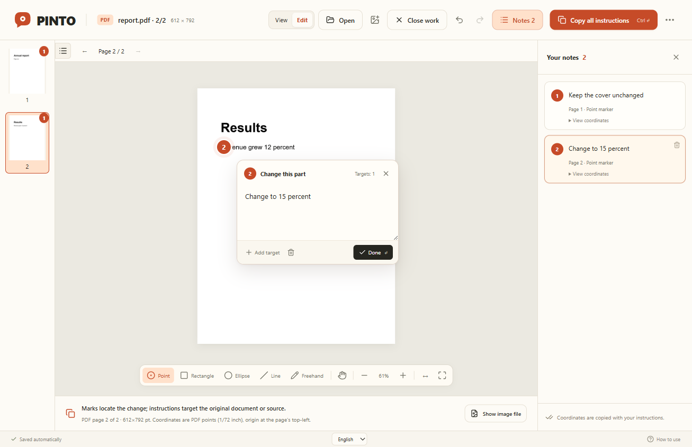
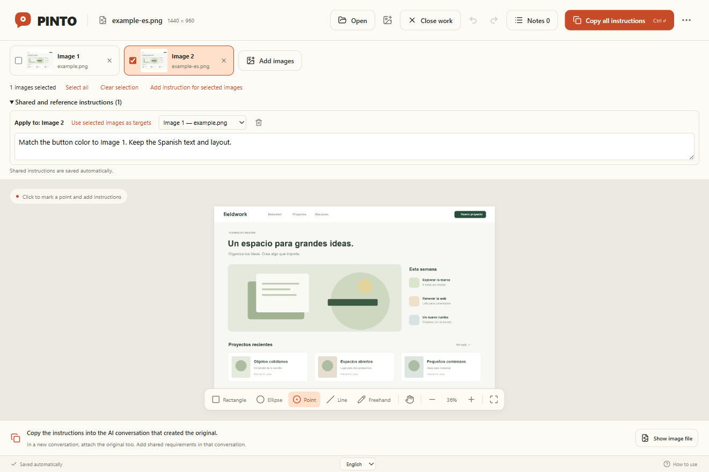

# PINTO

[English](README.md) · [Español](README.es.md) · [한국어](README.ko.md)


**Precise visual-editing instructions for the desktop coding agent you already use.**

Use PINTO alongside your agent in **thread0**, **Claude Code**, **Codex**, or another coding agent running on your computer. PINTO is a small, source-editable desktop app for Windows and macOS that helps you communicate exactly what you want changed in an image, PDF, HTML file, or local web app.

Open your images, mark the parts you want to change, and add notes. PINTO packages the file paths, original-pixel coordinates, selected regions, and reference-image relationships into instructions you can copy and paste into the agent you already use.

**PINTO makes the request precise. Your coding agent performs the edit**, using image generation or suitable tools it has available. If the agent can read the referenced local files, you do not need to attach the images again. In a new conversation without local file access, attach the originals too.

## Install with your AI

Paste this into thread0, Claude Code, or Codex:

```text
https://github.com/GenDistrict/pinto
Install this app. Read INSTALL.md, use English, and launch it when ready.
```

The agent follows [INSTALL.md](INSTALL.md), downloads the source, prepares the runtime, builds, and opens the app. Git and Node.js do not need to be preinstalled: a [source ZIP](https://github.com/GenDistrict/pinto/archive/refs/heads/main.zip) and a private Node.js runtime are supported. Initial installation requires internet and permission to run local commands. No personal developer certificate is required.

Manual installation from the downloaded source:

```powershell
# Windows
./install.ps1 -Language en
```

```sh
# macOS
sh ./install.sh --language en
```

## English, Spanish, and Korean

The app uses your system language, with English as the fallback. Change it using the selector at the bottom of the window; your choice persists across restarts. Tools, help, dialogs, app errors, and copied/exported instructions follow that language. Your own notes are never translated or overwritten.

| English | Español |
| --- | --- |
| [Actual app demo](docs/examples/pinto-en.mp4) | [Demostración real](docs/examples/pinto-es.mp4) |
| [Screenshot](docs/examples/pinto-en.png) | [Captura](docs/examples/pinto-es.png) |


Examples use the actual localized UI, sample image, and notes. See [internationalization](docs/I18N.md) for implementation and verification.

## Use it

PINTO 0.4 also opens **PDF, local HTML, and local web apps** in the same viewer. See [document and web editing](docs/DOCUMENTS.md) for the workflow and limits.

| Source | Instructions include |
| --- | --- |
| Image | Original pixels and file path |
| PDF | Original PDF path, page number, PDF-point coordinates, text under the mark |
| HTML | HTML path, CSS-pixel coordinates, CSS selector/text, navigation steps |
| Local web app | Current URL, CSS-pixel coordinates, element hints, instruction to edit project source |

Use **View / Edit** without losing the current page. Point is the first/default tool. PDF thumbnails live on the left, with an edge toggle; HTML uses navigation arrows and one Hand tool (drag to pan, click to interact). The instruction list can take you back to a marked page/screen. Notes and snapshots are saved locally and restored on restart.

**Open web app** is on the start screen and in More options. Use an `http://localhost`, `http://127.0.0.1`, or `http://[::1]` URL. **Open web window / Sign in** opens PINTO's own browser window; navigate or sign in there, then refresh the snapshot. It does not import credentials from thread0 or other browsers.



1. Open/drop images, PDF or HTML files; paste images; or open a local web-app URL.
2. Choose **Rectangle, Ellipse, Point, Line, or Freehand**. Click for points; drag for other shapes. Type the change you want.
3. Use **Add target** or Shift+click/drag for several targets in one instruction.
4. Click **Copy instructions**, or press Ctrl+Enter / ⌘Enter.
5. Paste into the AI conversation that created the original. In a new conversation, include the original too if needed.

**Close image** saves and returns to the start screen. Reopen it from Recent work. Undo/redo, zoom/pan, TXT export, and automatic saving are included.

Images are stored automatically. **More options → Change image storage folder** changes that location; it does not connect an AI account. Limits: 64 MB per image, 16,000 px per side, 64 million pixels total.

## Multi-image work



Open or drop several images together (up to 20), then switch using the thumbnails. Use **Add images** to append to the current work; **Open** starts another work. Each image keeps its own annotations and undo history while switching.

Check the images to target, then click **Add instruction for selected images**. Shared instructions save automatically. Choose an optional reference image—for example, apply Image 1's colors to Image 2. **Copy all instructions** and TXT export include every image's distinct path, dimensions, original-pixel coordinates, per-image notes, and shared/reference instructions. Even identical filenames are distinguished by stable image numbers and paths.

**Close work** saves the group; reopen it from Recent work. Removing a thumbnail only removes its membership, not its stored image or notes. Images used by a shared instruction must be removed from that instruction first. Numbers do not change after removal. If a file fails to import, successfully imported files are kept and the failure is reported. Change the storage folder from a single-image work before adding more images.

The agent performs the actual edits. In a new conversation without local file access, provide all the referenced originals.

## Make it yours

Ask your agent to change font sizes, shortcuts, or instruction formatting. In a new session, use **More options → Copy customization guide** to share source location and commands. Personal modifications are not automatically overwritten.

- [Installation and diagnostics](INSTALL.md)
- [Maintenance and recovery](docs/MAINTENANCE.md)
- [Agent instructions](AGENTS.md)
- [Original planning archive (Korean)](docs/PRODUCT_PLAN.md)

Target platforms: Windows 10+ (x64/ARM64) and macOS 13.5+ (Intel/Apple Silicon). Windows is tested locally; macOS CI/device results are tracked separately. Linux is not a supported target in this version.

## Development

```sh
npm ci
node node_modules/electron/install.js
npm run check
npm test
npm run build
npm start -- --language en
npm run test:e2e
```

Node.js 22.12+ is needed for these commands. The installers prepare it if necessary.

## License

[MIT](LICENSE). Use, modify, and redistribute the source. Dependencies retain their own licenses.
